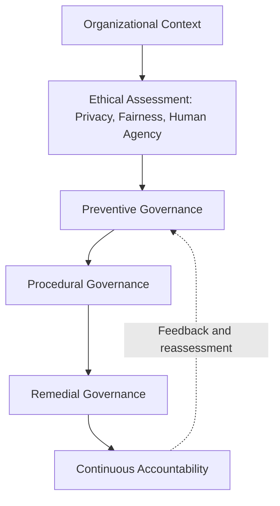

# Ethical Governance of Data-Driven Decision-Making

### Privacy, Algorithmic Fairness, and Human Agency

*A Critical Literature Review and Comparative Case Analysis*

**Author:** Keman Xiang  
**Research area:** Management and Information Systems  
**Academic context:** MGT 256 — Business Analytics for Management, University of California, Riverside  
**Report date:** November 2023

[Read the full research report (PDF)](./Ethical_Governance_Research_Report.pdf)

## 1. Project Overview

Data-driven decision-making can improve organizational efficiency and consistency while introducing risks to privacy, equitable opportunities, and individuals' ability to understand or challenge decisions. This study examines how these ethical tensions arise from the interaction of data practices, organizational decision criteria, and institutional arrangements.

Drawing on a critical narrative literature review and a structured comparison of three documentary cases, the study integrates contextual integrity, organizational justice, and human agency. It proposes a lifecycle-oriented ethical governance framework connecting preventive, procedural, and remedial safeguards with continuous accountability. It also explores the theoretical implications of these mechanisms for AI-enabled workplace inclusion.

**Keywords:** Data ethics, contextual integrity, organizational justice, human agency, algorithmic governance, workplace inclusion.

## 2. Research Questions

The overarching research question is how data-driven organizational practices create tensions surrounding privacy, fairness, and human agency, and how organizational governance might address them.

|Research Question|Analytical Focus|
|---|---|
|RQ1 — Privacy|How do data collection, integration, and secondary use challenge contextual privacy and informational autonomy?|
|RQ2 — Fairness|How may data-driven decision practices reproduce or amplify inequalities?|
|RQ3 — Human Agency|How may information and control asymmetries shape the capacity to understand, influence, and contest decisions?|
|RQ4 — Governance|What governance mechanisms address these tensions, and what limits their implementation?|

## 3. Theoretical Foundations

|Theoretical Lens|Core Reference|Application|
|---|---|---|
|Contextual Integrity|Nissenbaum (2004)|Evaluates whether information flows are appropriate to their social context, purpose, recipients, and transmission conditions.|
|Organizational Justice|Colquitt (2001)|Examines distributive, procedural, interpersonal, and informational dimensions of fairness.|
|Human Agency|Bandura (2001)|Examines the conditions under which individuals can understand, influence, and challenge decisions affecting them.|

Complementary literature on sociotechnical fairness, algorithmic control, employee voice, responsible AI governance, and workplace inclusion informs the interpretation of organizational practices and governance responses.

## 4. Research Methodology

The study adopts a qualitative, theory-informed research design based on secondary documentary evidence.

|Method|Purpose|
|---|---|
|Critical Narrative Literature Review|Integrate foundational concepts and critically examine competing perspectives on data ethics and governance.|
|Qualitative Document Analysis|Examine scholarly studies, regulatory decisions, legal complaints, and binding governance obligations.|
|Purposive Case Selection|Select complementary cases illustrating different ethical mechanisms and organizational settings.|
|Within-case Analysis|Examine documented practices, actors, ethical tensions, governance responses, and uncertainty.|
|Cross-case Comparison|Identify recurring themes, contextual differences, and rival explanations.|
|Conceptual Synthesis|Develop an integrated governance framework and theoretical propositions for future research.|

The analytical architecture distinguishes documented practices, explanatory mechanisms, and governance responses. Legal allegations, regulatory findings, and settlement obligations are interpreted according to their respective evidentiary status.

## 5. Documentary Cases

|Case|Research Focus|Principal Evidence|Governance Implications|
|---|---|---|---|
|Governor William Weld|Health-data re-identification and contextual disclosure risk|Sweeney (1997); Barth-Jones (2012); McGraw (2013)|Adaptive data stewardship, residual risk assessment, and preservation of legitimate research utility.|
|Facebook–Cambridge Analytica|Third-party data access, secondary use, and distributed accountability|FTC Commission Opinion and Final Order (2019); Facebook privacy settlement materials|Meaningful disclosure, downstream responsibility, and third-party oversight.|
|iTutorGroup|Alleged exclusionary criteria in automated recruitment|EEOC complaint (2022) and consent decree (2023)|Fair screening criteria, complaint procedures, monitoring, and remedial access.|

The iTutorGroup consent decree resolved litigation without admissions or judicial findings of fact. The case is used to examine alleged decision mechanisms and binding safeguards, not to establish independently verified discrimination or model bias. The Cambridge Analytica analysis does not infer political persuasion effectiveness or election outcomes.

## 6. Key Findings

|Cross-case Theme|Analytical Finding|
|---|---|
|T1 — Contextual Boundaries|Information appropriateness and disclosure risk depend on the purpose, recipients, and surrounding information environment.|
|T2 — Embedded Organizational Rules|Automated systems may implement exclusionary organizational criteria rather than independently create inequality.|
|T3 — Information and Control Asymmetries|Organizational access to information may exceed individuals' practical capacity to understand or control its use.|
|T4 — Distributed Accountability|Governance responsibilities should reflect the roles and control capabilities of downstream actors.|
|T5 — Procedural Safeguards|Complaint, review, and renewed-access provisions can address distinct barriers to contesting decisions.|
|T6 — Lifecycle Governance|Prevention, procedural oversight, and remedies are complementary components of ethical governance.|

The central analytical insight is that ethical risks arise not only from computational methods but also from the organizational rules, information flows, and institutional arrangements surrounding their implementation. Formal safeguards do not, by themselves, demonstrate effective governance or improved individual experiences.

## 7. Integrated Ethical Governance Framework

The study proposes a conceptual framework that organizes governance around the decision lifecycle (Figure 7, p. 16 of the report).

|Governance Function|Illustrative Organizational Actions|
|---|---|
|Preventive Governance|Document data purposes, minimize unnecessary attributes, assess risks, and review decision criteria.|
|Procedural Governance|Provide meaningful disclosure, supervise third parties, enable review, and support contestability.|
|Remedial Governance|Correct records or decisions, delete affected data, provide appropriate compensation, and restore access where applicable.|
|Continuous Accountability|Assign responsibilities, maintain documentation, monitor implementation, and incorporate feedback into future design.|

The framework is an analytical organizing device rather than an empirically validated causal model or universal legal standard.

## 8. Theoretical Propositions

|ID|Proposition|
|---|---|
|P1|Privacy risks may increase when information practices depart from context-specific norms without adequate safeguards.|
|P2|Automated systems may reproduce or amplify inequality when exclusionary organizational criteria are embedded in their implementation.|
|P3|Information and control asymmetries may constrain agency when opportunities to understand or contest decisions are absent.|
|P4|Governance may remain incomplete when accountability excludes downstream recipients or derived analytical products.|
|P5|Accessible and enforceable procedural and remedial safeguards may strengthen the capacity of affected individuals to exercise agency.|
|P6|Privacy protection, fair procedures, and meaningful agency may enable workplace inclusion but are insufficient by themselves to establish inclusive experiences.|

These propositions provide directions for future empirical investigation rather than tested hypotheses.

## 9. Implications for AI-Enabled Workplace Inclusion

The framework extends to AI-mediated organizational practices such as recruitment, performance evaluation, and resource allocation. Appropriate information use, defensible decision procedures, and meaningful opportunities for voice and participation may create enabling conditions for inclusion.

Following Shore et al. (2011), inclusion involves both belongingness and recognition of uniqueness. Fair access to employment is therefore not equivalent to an inclusive workplace experience. Direct research with employees and managers is necessary to establish how governance arrangements influence perceived fairness, voice, autonomy, and inclusion across different social and cultural groups.

## 10. Research Contributions

- **Theoretical integration:** Connects contextual privacy, organizational justice, and human agency within a common analytical perspective.
- **Comparative analysis:** Examines complementary ethical mechanisms across healthcare information, digital platforms, and automated recruitment.
- **Conceptual development:** Proposes a lifecycle-oriented governance framework and six theoretical propositions.
- **Managerial implications:** Connects ethical principles with decision design, institutional responsibility, oversight, and remedies.
- **Future research:** Establishes a conceptual foundation for investigating responsible AI and workplace inclusion.

## 11. Limitations and Research Transparency

The study relies on secondary documents and does not involve primary interviews, surveys, experiments, statistical modeling, or direct algorithmic auditing. The three cases are heterogeneous and purposively selected around ethical controversies; they cannot establish prevalence, causal effects, or comparative intervention effectiveness. Documentary support is stronger for privacy and formal governance than for experienced agency or workplace inclusion.

Future research could combine employee and manager interviews, comparative organizational studies, longitudinal observation, and vignette experiments to evaluate the proposed relationships. The report draws on literature and documentary evidence available before November 7, 2023.

## 12. Selected References

- Nissenbaum, H. (2004). Privacy as contextual integrity. *Washington Law Review, 79*(1), 119–157.
- Colquitt, J. A. (2001). On the dimensionality of organizational justice. *Journal of Applied Psychology, 86*(3), 386–400. [DOI](https://doi.org/10.1037/0021-9010.86.3.386)
- Bandura, A. (2001). Social cognitive theory: An agentic perspective. *Annual Review of Psychology, 52*, 1–26. [DOI](https://doi.org/10.1146/annurev.psych.52.1.1)
- Selbst, A. D., et al. (2019). Fairness and abstraction in sociotechnical systems. [DOI](https://doi.org/10.1145/3287560.3287598)
- Kellogg, K. C., Valentine, M. A., & Christin, A. (2020). Algorithms at work: The new contested terrain of control. [DOI](https://doi.org/10.5465/annals.2018.0174)
- Raji, I. D., et al. (2020). Closing the AI accountability gap. [DOI](https://doi.org/10.1145/3351095.3372873)
- Shore, L. M., et al. (2011). Inclusion and diversity in work groups: A review and model for future research. [DOI](https://doi.org/10.1177/0149206310385943)

The complete bibliography and documentary source references are provided in the research report.

## 13. Repository Contents

|File|Description|
|---|---|
|[Ethical_Governance_Research_Report.pdf](./Ethical_Governance_Research_Report.pdf)|Full 20-page academic research report, including theoretical foundations, case analyses, conceptual figures, propositions, and references.|
|README.md|Research overview, methodology, findings, governance framework, and limitations.|

## Author

**Keman Xiang**  
MBA, University of California, Riverside  
Research Portfolio — Management and Information Systems
